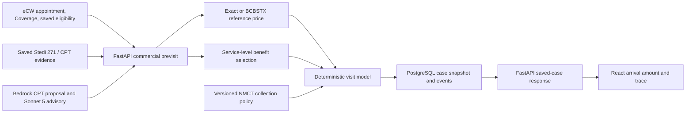

# Commercial collection engine: current architecture

Status: first milestone on `feature/collection-engine-bcbstx-milestone`; `COLLECTION_ENGINE_V2_ENABLED` defaults off. The live engineering guide remains the operational entry point.

## Existing paths retained

| Responsibility | Current source | First-milestone change |
| --- | --- | --- |
| Appointment and coverage | `commercial_previsit_submit.py`, `ecw/ecw_coverage.py` | Existing patient and policy binding remains authoritative. |
| Saved eCW eligibility | `ecw/ecw_insurance_evidence.py`, `ecw_benefits.py` | Existing read-only FHIR path reused. Raw Eligibility Insights 271 API access is unconfirmed. |
| Stedi normalization | `stedi_benefits/selection.py`, `terms.py`, `normalize.py` | Selected row IDs and scoped terms feed each service line. No new paid request is made by the visit model. |
| CPT proposal and editing | `cpt_suggester.py`, `ServicePlanner.tsx` | Existing Bedrock suggestion and clinician edit path retained. A selected procedure remains a planning service until confirmed. |
| Rate lookup | `commercial_store.matching_rates`, `commercial_previsit_rate_reference.py` | BCBSTX scoped active rates can be a cross-payer reference independent of the target connection. |
| Existing arithmetic | `pricing/visit.py`, `visit_estimate.py`, `collection/office_copay.py` | Legacy behavior remains behind the default-off flag; `visit_collection_model.py` computes one selected visit when enabled. |
| Policy and saving | `commercial_store.py`, `collection_guidance.py`, `commercial_previsit_status.py` | Multiple exact-scope approved policy versions and saved/reloaded `visit_model`; no synthetic fixture grants real approval. |
| Staff amount | `collectionAtVisitRow.ts`, `ArrivalAmountSummary.tsx` | If a visit model exists, both show backend `collect_now_cents`; planning stays separate. |

The first milestone does not remove historical payer branches. Their behavior and replacement criteria are tracked in `WORKAROUND_REMOVAL_PLAN.md`.

## Data and deployment boundaries

Saved case JSON is protected by existing patient/practice authorization; raw payer objects remain in protected S3. Research prompts contain selected CPTs, normalized numeric terms, source IDs and controlled review flags, with no patient identifiers or raw review text. The infrastructure branch adds Sonnet 5 invoke permission and a default-off collection flag. Nothing here authorizes production deployment, payer transactions or a live NMCT collection policy.
