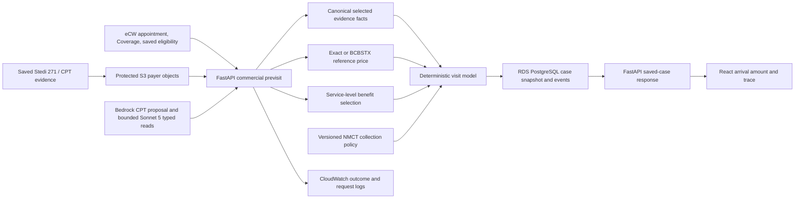

# Commercial collection engine: current architecture

Status: first milestone on `feature/collection-engine-bcbstx-milestone`; `COLLECTION_ENGINE_V2_ENABLED` defaults off. The live engineering guide remains the operational entry point.

## Existing paths retained

| Responsibility | Current source | First-milestone change |
| --- | --- | --- |
| Appointment and coverage | `commercial_previsit_submit.py`, `ecw/ecw_coverage.py` | Existing patient and policy binding remains authoritative. |
| Saved eCW eligibility | `ecw/ecw_insurance_evidence.py`, `ecw_benefits.py` | Existing read-only FHIR path reused. Raw Eligibility Insights 271 API access is unconfirmed. |
| Stedi normalization | `stedi_benefits/selection.py`, `terms.py`, `normalize.py` | Selected row IDs and scoped terms feed each service line. No new paid request is made by the visit model. |
| CPT proposal and editing | `cpt_suggester.py`, `ServicePlanner.tsx` | Existing Bedrock suggestion and clinician edit path retained. A selected procedure remains a planning service until confirmed. |
| Rate lookup | `commercial_store.matching_rates`, `commercial_previsit_rate_reference.py` | BCBSTX scoped active rates can be a cross-payer reference independent of the target connection. |
| Existing arithmetic | `pricing/visit.py`, `visit_estimate.py`, `collection/office_copay.py` | Legacy behavior remains behind the default-off flag; `visit_collection_model.py` computes one selected visit when enabled. |
| Policy and saving | `commercial_store.py`, `canonical_evidence.py`, `collection_guidance.py`, `commercial_previsit_status.py` | Source-scoped selected facts, multiple exact-scope approved policy versions and saved/reloaded `visit_model`; no synthetic fixture grants real approval. |
| Staff amount | `collectionAtVisitRow.ts`, `ArrivalAmountSummary.tsx` | If a visit model exists, both show backend `collect_now_cents`; planning stays separate. |

The first milestone does not remove historical payer branches. Their behavior and replacement criteria are tracked in `WORKAROUND_REMOVAL_PLAN.md`.

## Phase 0 function and data inventory

| Decision point | Exact current functions or components | Duplicate/compatibility concern |
| --- | --- | --- |
| Saved eCW evidence | `ecw/ecw_insurance_evidence.py:fetch_saved_eligibility`, `probe_saved_eligibility`; `ecw_benefits.py` | FHIR eligibility is read-only; raw Eligibility Insights 271 access is not established. |
| Stedi row selection and interpretation | `stedi_benefits/selection.py:select_benefit_rows`, `terms.py:select_cost_share_rows`, `normalize.py:normalize_stedi_271` | General STC rows and narrower copay rows may overlap; source row IDs must survive into the visit trace. |
| Service planning | `cpt_suggester.py:recommend_visit_plan`, `suggest_cpt_codes`; `commercial_previsit_pricing.py:_previsit_codes`; `ServicePlanner.tsx` | Suggested alternatives are not clinician-confirmed billable services; edits change pricing scope. |
| Exact/reference rate selection | `commercial_store.py:matching_rates`; `commercial_previsit_rate_reference.py:_attach_temporary_blue_cross_rates`; `commercial_previsit_pricing.py:_previsit_range` | Legacy Cigna/Aetna/UHC and public CTA reference branches coexist; the new model accepts only versioned clinic library benchmark lines. |
| Legacy service arithmetic | `pricing/visit.py:price_lines`; `commercial.py:estimate`; `visit_estimate.py:planning_estimate`, `arrival_collection`, `combined_emg_plan`; `encounter_summary.py:build` | These independently produce line share, planning or arrival figures. They remain behind the default-off migration flag until replay. |
| Copay and final policy | `collection/office_copay.py:office_copay_amount`, `diagnostic_day_copay_amount`; `collection_guidance.py:build`; `visit_collection_model.py:build` | The legacy path chooses one partial advance; the new path aggregates independently applicable groups and sets the backend alias to its policy decision. |
| Save and reload | `commercial_previsit_finish.py:_finish_previsit`; `commercial_previsit_status.py:_previsit_result`; `commercial_store.py` | Each saved revision must retain the same selected evidence and decision trace; a current-config reload is not historical config proof. |
| React amount and explanations | `collectionAtVisitRow.ts:collectionAtVisitRow`; `provisionalEstimateAmounts.ts`; `coinsuranceFormula.ts`; `deriveCommercialEstimateView.ts`; `ArrivalAmountSummary.tsx` | Legacy UI can calculate pending/proxy balance or formula text when backend `amount_cents` is null. With `visit_model`, the collection slot uses only backend `collect_now_cents`. |

Current data tables include `insurance_cases`, `insurance_case_events`, `commercial_payer_connections`, `commercial_provider_networks`, `commercial_estimation_profiles`, `commercial_rate_versions`, and `commercial_rate_lines`. The branch adds versioned `commercial_collection_policy_versions` and stores multiple approved visit-policy references in the connection's `rules.visit_collection_policies`, while retaining the old `rules.collection_policy` compatibility path. Protected raw payer objects are stored by S3 reference; CloudWatch carries operational events without payer payloads. The infrastructure branch adds a default-off feature flag and scoped Sonnet 5 invoke permission. [Phase 0 rate coverage](BCBSTX_REFERENCE_RATE_COVERAGE.md) and the [private dated audit](../../../contextforcodex/collection-engine-phase0-audit-2026-11-02.md) contain the measured baseline and historical limits.

## Data and deployment boundaries

Saved case JSON is protected by existing patient/practice authorization; raw payer objects remain in protected S3. Research prompts contain selected CPTs, normalized numeric terms, source IDs and controlled review flags, with no patient identifiers or raw review text. The infrastructure branch adds Sonnet 5 invoke permission and a default-off collection flag. Nothing here authorizes production deployment, payer transactions or a live NMCT collection policy.
